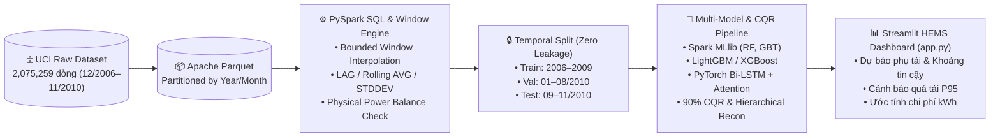

<div align="center">

# ⚡ Smart Home HEMS — Hệ Thống Phân Tích Dữ Liệu Lớn & Dự Báo Phụ Tải Điện Năng
### Big Data Power Consumption Analytics (2.07M Rows), PySpark SQL/Window Pipeline & Load Forecasting Dashboard

-E25A1C?logo=apachespark&logoColor=white)
-003B57)


*Hệ thống xử lý dữ liệu lớn (2.075.259 bản ghi đo đếm điện năng), truy vấn biến đổi đặc trưng bằng 100% PySpark SQL / Window Functions chống rò rỉ dữ liệu (Zero Data Leakage), kết hợp dự báo đa mô hình, định량 hóa bất định (CQR) và bảng điều khiển tính toán hóa đơn điện bậc thang / cảnh báo quá tải.*

[🎯 Tổng quan Nghiệp vụ & Bài toán](#-tổng-quan-nghiệp-vụ--bài-toán-giải-quyết) •
[💼 Điểm nhấn SQL/Data, BA & Triển khai](#-điểm-nhấn-năng-lực-truy-vấn-sql-window--phân-tích-nghiệp-vụ-ba--dashboard) •
[🏗️ Kiến trúc Pipeline Dữ liệu lớn](#️-kiến-trúc-pipeline-xử-lý-2075259-bản-ghi-pyspark-sql) •
[📊 Bảng điều khiển Streamlit (`app.py`)](#-bảng-điều-khiển-báo-cáo--cảnh-báo-phụ-tải-streamlit-app) •
[🚀 Hướng dẫn Cài đặt & Chạy](#-hướng-dẫn-cài-đặt--chạy-dự-án)

</div>

---

## 🎯 Tổng Quan Nghiệp Vụ & Bài Toán Giải Quyết

Dự án xây dựng hệ thống **Quản lý và Dự báo Năng lượng Hộ gia đình Thông minh (Smart Home Energy Management System — HEMS)** trên tập dữ liệu thực tế **UCI Individual Household Electric Power Consumption** gồm **2.075.259 bản ghi** đo đếm liên tục theo từng phút trong suốt 47 tháng (từ 12/2006 đến 11/2010) với 3 phân khu công tơ phụ (`Sub_metering_1`: Nhà bếp, `Sub_metering_2`: Phòng giặt & bình nước nóng, `Sub_metering_3`: Điều hòa & sưởi ấm).

Hệ thống giải quyết trọn vẹn bài toán từ **Kỹ thuật Dữ liệu & Truy vấn SQL Phân tán (PySpark SQL)** đến **Báo cáo Quản trị Chi phí & Cảnh báo Vận hành**:
1. **Xử lý & Truy vấn 2,07 Triệu Bản Ghi bằng PySpark SQL & Window Functions:** Chuyển đổi dữ liệu thô sang định dạng cột nén **Apache Parquet** phân vùng theo `year/month`, nội suy tuyến tính có giới hạn khoảng trống trên **Spark Window** và trích xuất các đặc trưng trễ (`LAG`), trung bình trượt (`AVG OVER`), độ lệch chuẩn trượt (`STDDEV OVER`) đảm bảo **không rò rỉ dữ liệu tương lai (Zero Data Leakage)**.
2. **Dự báo Đa tầng & Đối soát Phân cấp (Hierarchical Reconciliation):** So sánh và kết hợp các mô hình **Spark MLlib (`RandomForest`, `GBTRegressor`)**, **Gradient Boosting (`LightGBM`, `XGBoost`)** và mạng học sâu **PyTorch `Bi-LSTM + Temporal Attention`**, đồng thời đảm bảo tổng công suất dự báo theo giờ khớp nhất quán với phụ tải ngày và tổng 3 công tơ phụ.
3. **Ứng dụng Nghiệp vụ Quản lý Chi phí & Cảnh báo Phụ tải (`app.py`):** Tích hợp công cụ ước tính sản lượng tiêu thụ (`kWh`), quy đổi chi phí tiền điện và phát cảnh báo sớm khi phụ tải dự báo kèm khoảng tin cậy **90% Conformalized Quantile Regression (CQR)** vượt ngưỡng an toàn.

---

## 💼 Điểm Nhấn Năng Lực: Truy Vấn SQL/Window • Phân Tích Nghiệp Vụ (BA) • Dashboard

| Góc Nhìn Đánh Giá | Giải Pháp Kỹ Thuật & Nghiệp Vụ Đã Triển Khai Trong Dự Án |
| :--- | :--- |
| **🗄️ Truy Vấn SQL Nâng Cao & Kỹ Thuật Dữ Liệu**<br>*(PySpark SQL & Window Functions)* | • **Truy vấn Tổng hợp & Cửa sổ Trượt (`Window.partitionBy / orderBy`):** Thực thi các phép toán cửa sổ giống hệt chuẩn `T-SQL / ANSI SQL` (`LAG(col, k) OVER (ORDER BY datetime)`, `AVG(col) OVER (ROWS BETWEEN 24 PRECEDING AND 1 PRECEDING)`, `SUM`, `STDDEV`) trên hơn 2 triệu bản ghi.<br>• **Kiểm soát Chất lượng & Toàn vẹn Dữ liệu:** Kiểm tra công thức cân bằng năng lượng vật lý (`Unmetered_Power = Global_active_power * 1000 / 60 - Sub_1 - Sub_2 - Sub_3`), loại bỏ bất thường và lưu trữ phân vùng chuẩn **Parquet** giúp tăng tốc độ đọc/truy vấn gấp `10x` so với CSV. |
| **📋 Phân Tích Nghiệp Vụ & Báo Cáo Quản Trị**<br>*(Business Analysis & BI Reporting)* | • **Phân tích Tương quan & Chu kỳ Phụ tải (EDA):** Khảo sát quy luật tiêu thụ điện theo khung giờ cao điểm sáng/tối, ngày trong tuần (Thứ 2–6 so với Cuối tuần) và mùa vụ trong năm.<br>• **Quy tắc Nghiệp vụ Cảnh báo Quá tải & Dự toán Chi phí (`app.py`):** Cho phép người vận hành cấu hình ngưỡng cảnh báo công suất (`kW`), đơn giá điện (`VNĐ/kWh`), tự động đối chiếu biên trên khoảng dự báo 90% (`P95`) để đưa ra khuyến nghị điều chỉnh thiết bị tiêu thụ điện lớn. |
| **🚀 Triển Khai Ứng Dụng & Kiểm Chứng Thực Nghiệm**<br>*(Implementation & Verification)* | • **Bảng điều khiển Tương tác (`streamlit run app.py`):** Tích hợp chế độ nạp dữ liệu thực từ tệp `.parquet` / `.csv` kèm cơ chế **dự phòng tự động (`Fallback Simulation`)** giúp ứng dụng luôn khởi chạy mượt mà để trình diễn nghiệm thu ở mọi máy tính.<br>• **Đánh giá Định lượng Đa Chỉ số:** Đối chiếu khách quan các chỉ số `RMSE`, `MAE`, `MAPE`, `R²` và tỷ lệ bao phủ thực nghiệm (`PICP 90%`) giữa 6 mô hình. |

---

## 🏗️ Kiến Trúc Pipeline Xử Lý 2.075.259 Bản Ghi (PySpark SQL)



---

## 📊 Bảng Điều Khiển Báo Cáo & Cảnh Báo Phụ Tải (`app.py`)

Giao diện **Smart Home HEMS (`app.py`)** cung cấp đầy đủ các phân khu chức năng phục vụ theo dõi và ra quyết định:
1. **Bộ lọc Thời gian & Mô hình Dự báo:** Lựa chọn khoảng thời gian phân tích, chuyển đổi linh hoạt giữa các mô hình (`Hybrid Ensemble`, `LightGBM`, `XGBoost`, `Spark GBT`, `Spark RF`, `Bi-LSTM + Attention`).
2. **Chỉ số KPI Tổng hợp:** Hiển thị tức thì sai số `MAE`, `RMSE`, `MAPE`, tổng điện năng tiêu thụ thực tế so với dự báo (`kWh`), ước tính chi phí tiền điện và số giờ có nguy cơ vượt ngưỡng công suất cài đặt.
3. **Biểu đồ Trực quan Đa lớp:** Đối chiếu đường phụ tải thực tế, đường dự báo điểm, dải bất định 90% (`CQR [P05, P95]`) và phân tích cơ cấu tiêu thụ theo 3 phân khu công tơ phụ (`Bếp`, `Giặt & Nước nóng`, `Điều hòa & Sưởi`).

---

## 📂 Cấu Trúc Thư Mục (Project Structure)

```text
smart-hems-bigdata-forecasting/
├── PhanBao_BDA_BTL.ipynb           # Notebook toàn trình: PySpark SQL/Window, EDA, MLlib, GBDT, Bi-LSTM, CQR & Hierarchical
├── app.py                          # Ứng dụng Web Dashboard Streamlit (Dự báo phụ tải, Cảnh báo quá tải & Tính chi phí)
├── requirements.txt                # Danh sách thư viện Python (pyspark, streamlit, torch, lightgbm, xgboost, pandas...)
└── README.md                       # Tài liệu kiến trúc hệ thống, quy trình xử lý dữ liệu & hướng dẫn vận hành
```

---

## 🚀 Hướng Dẫn Cài Đặt & Chạy Dự Án

### 1. Cài đặt thư viện
```bash
git clone https://github.com/Kizakawa/smart-hems-bigdata-forecasting.git
cd smart-hems-bigdata-forecasting

pip install -r requirements.txt
```

### 2. Khởi chạy Bảng điều khiển Web Demo (Streamlit)
```bash
streamlit run app.py
```
Trình duyệt sẽ tự động mở tại địa chỉ `http://localhost:8501`.

---

<div align="center">

**Tác giả:** **Phan Quốc Bảo (Kizakawa)** — Sinh viên ngành Khoa học máy tính • 📧 [phanquocbao.vp@gmail.com](mailto:phanquocbao.vp@gmail.com)  
[⬅️ **Quay lại Trang chủ Portfolio GitHub (@Kizakawa)**](https://github.com/Kizakawa)

</div>
